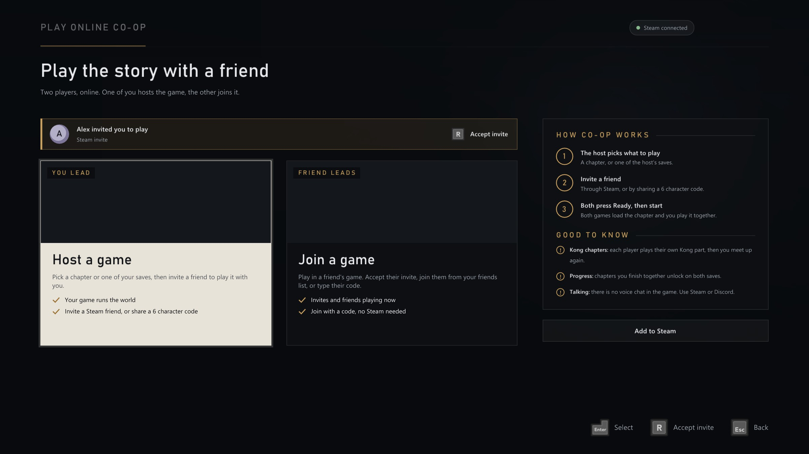
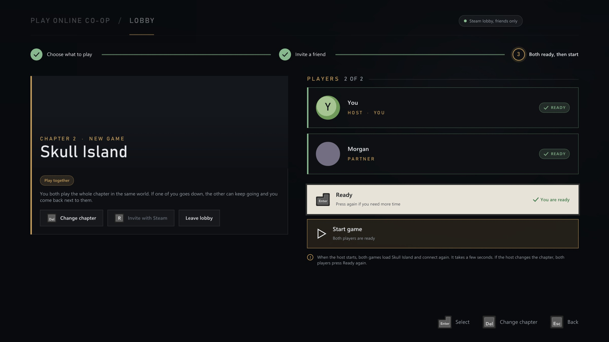
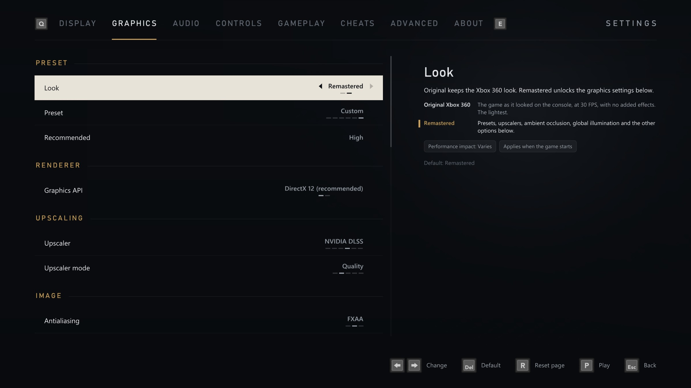
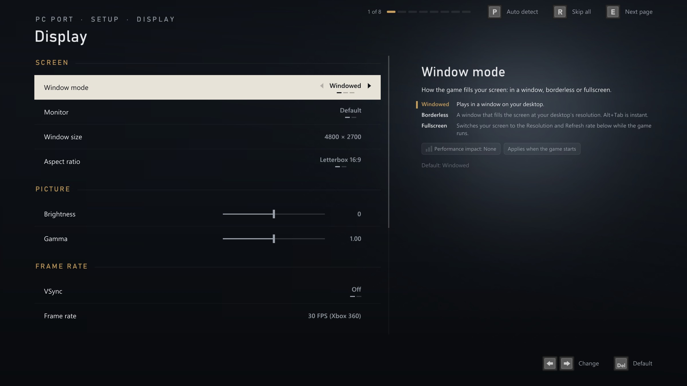
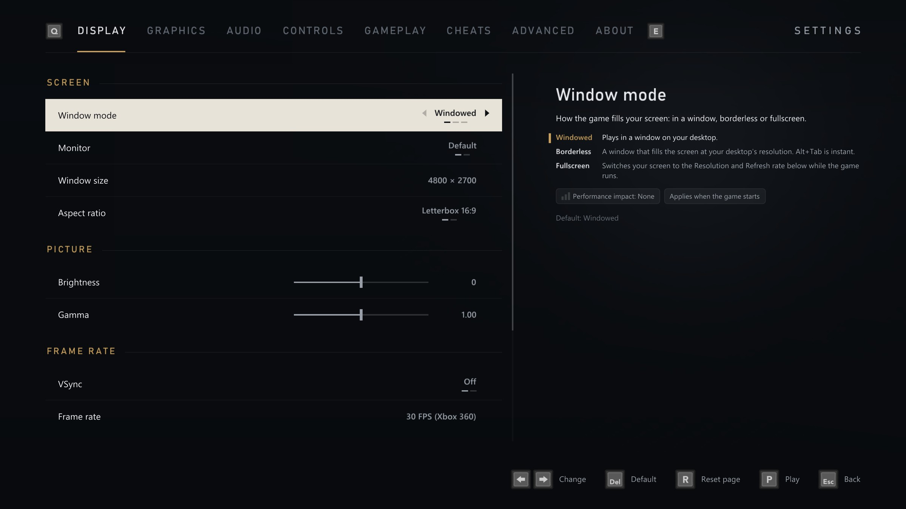
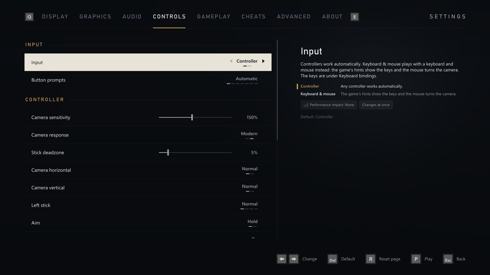

<div align="center">


## King Kong Remastered is out now

[](https://kong.tekrantgaming.com/)
&nbsp;
[](https://github.com/TekRantGaming/king-kong-recompiled-beta/releases/latest)

</div>

<div align="center">


### Peter Jackson's King Kong on PC, running natively, with the launcher and options of a modern PC release.

**Version 2.0.0: King Kong Remastered.** For Windows, Linux and Steam Deck, now with online co-op, our own renderer with modern lighting, and a launcher made for the couch.

[](https://github.com/TekRantGaming/king-kong-recompiled/releases/latest)
&nbsp;
[](https://github.com/TekRantGaming/king-kong-recompiled/releases/latest)
&nbsp;
[](https://www.youtube.com/watch?v=P5wmya5mT7E)
&nbsp;
[](https://discord.gg/8eakYSvBZS)

[](https://github.com/TekRantGaming/king-kong-recompiled/releases/latest)
[](https://github.com/TekRantGaming/king-kong-recompiled/releases)

[](https://kong.tekrantgaming.com)
[](https://quiverlauncher.com/apps/peter-jackson-s-king-kong-the-official-game-of-the-movie-king-kong-pc-port)

<br>






<sub>The original Xbox 360 game code, translated to native PC code with the <a href="https://github.com/rexglue/rexglue-sdk">ReXGlue SDK</a>. <b>No game files included</b>: bring your own copy of the King Kong Xbox 360 disc.</sub>

</div>

<br>

## At a glance

| | | |
| :--- | :--- | :--- |
| 👥 **Online co-op** for two players (early access) | 🎨 **Our own renderer**, DirectX 12 or Vulkan | ☀️ **Global illumination**, sharper shadows, water reflections and light shafts |
| 🖥️ **Up to 8K**, any frame rate up to 240 or unlimited | 🎮 **Any controller**, or a real keyboard and mouse layout | 🧩 **Plays past the "VENTURE" freeze** that stops Xenia |
| ✨ **DLSS, FSR 3.1, FSR 4 and XeSS**, plus FSR 1 and NIS, ambient occlusion, presets | 📺 **Original Xbox 360 look** in one click, or Remastered | 🔭 **Wider field of view**, up to 110° |
| 🏆 **Achievements** with Xbox 360 or Steam style popups | 🕹️ **All ten cheats** as switches | 🎥 **Camera shake**, vibration and every control tunable |
| 💿 **Install from your own disc** in a few clicks | 🔄 **Updates itself**, with a stable and a beta channel | 🚂 **Add to Steam** with artwork, ready for the Steam Deck |
| 🐧 **Linux and Steam Deck** with a native AppImage (experimental) | 👀 **See who's playing**, anonymously | 💬 **[Join the Discord](https://discord.gg/8eakYSvBZS)** for news and early builds |
| 🏠 **The launcher is the main menu**, with all 42 chapters open | 🧭 **Auto detect** sets the game up for your PC | ⏸️ **A new pause menu**, with settings and photo mode |
| 🧰 **The Workshop**: texture packs and mods | 🎬 **Restored PS2 cutscenes**, the Weta Artbook and the manual | 📐 **Ultrawide built in**, 21:9 and 32:9 with nothing stretched |
| 📊 **Benchmark** on the main menu | 🚀 **17,652 graphics pipelines** prepared before you play | 🌅 **HDR (experimental)** in the F8 graphics panel |

Full notes for every version are in the [changelog](CHANGELOG.md) and on the [releases page](https://github.com/TekRantGaming/king-kong-recompiled/releases). The [website](https://kong.tekrantgaming.com) has a page for every feature.

<div align="center">

## Modern graphics


<sub><b>Ambient occlusion</b>: soft shading in corners, creases and under rocks, grass and people</sub>

<br><br>


<sub>Up close, at full size</sub>

<br><br>


<sub><b>Distance fog</b>, on or off</sub>

<br><br>


<sub><b>AMD FSR 1 and NVIDIA NIS</b> keep a lower resolution sharp (zoomed 2x)</sub>

<br><br>


<sub><b>New in 2.0.0</b>: global illumination, sharper shadows, water reflections, light shafts, DLSS, FSR 3.1, FSR 4 and XeSS, and a panel that explains every setting</sub>

## A launcher made for the couch


<sub><b>Set up from your own disc</b> &nbsp;·&nbsp; <b>Graphics</b>: presets, upscalers, resolution and effects</sub>

<br><br>


<sub><b>Gameplay</b>: frame rate, field of view, camera shake &nbsp;·&nbsp; <b>Controls</b>: remapping, mouse look, button prompts</sub>

<br><br>


<sub><b>Cheats</b> as switches &nbsp;·&nbsp; <b>Achievements</b> with popups and your choice of sound</sub>

<br><br>


<sub><b>Add to Steam</b> with its artwork &nbsp;·&nbsp; <b>Display</b>: windowed, fullscreen, any monitor</sub>

<br><br>


<sub><b>About</b>: updates, stable or beta, Discord &nbsp;·&nbsp; <b>What's new</b> after every update</sub>

<br><br>



<sub><b>New in 2.0.0</b>: a first setup with Auto detect &nbsp;·&nbsp; settings that explain themselves</sub>

<br><br>



<sub><b>Controls</b> in 2.0.0 &nbsp;·&nbsp; <b>Play Online Co-op</b>: the lobby</sub>

</div>

<br>

> [!NOTE]
> **In active development.** New versions come out often, and the launcher offers each one when it opens. A full playthrough hasn't been confirmed yet, so please [report anything that goes wrong](#reporting-a-problem). What changed in each version is on the [releases page](https://github.com/TekRantGaming/king-kong-recompiled/releases).

## Getting started

**You need:** Windows 10 or 11 (64 bit) or Linux (x86 64 bit), a graphics card that supports DirectX 12 or Vulkan, about 7 GB of free space, and a disc image you made from your own Peter Jackson's King Kong Xbox 360 disc (see [Which version you need](#which-version-you-need)).

1. Download the **KingKong-...-windows-x64.zip** file from the [latest release](https://github.com/TekRantGaming/king-kong-recompiled/releases/latest) and unzip it anywhere. On Linux, see [Linux and Steam Deck](#linux-and-steam-deck-experimental).
2. Run **king_kong.exe**. The launcher opens on its first setup.
3. Choose **Select disc image** and pick your King Kong disc image. The launcher checks it, copies the game files (about 6.3 GB) into a `game` folder next to the exe and takes its artwork from them.
4. The graphics are prepared once, with one progress bar. Then setup offers **Auto detect**, the HD texture pack and the PS2 cutscenes, and walks you through the graphics options and button prompts.
5. Press **PLAY**.

The download contains only this port. **No game files are included**: they come from your own disc. Your saves and settings are kept in `Documents\king_kong`. The port is also listed on [Quiver Launcher](https://quiverlauncher.com/apps/peter-jackson-s-king-kong-the-official-game-of-the-movie-king-kong-pc-port), where you can see how it runs for other players.

### Which version you need

The port is made for this disc only. The 2005 PC version and discs for other platforms will not work.

| | |
| --- | --- |
| Game | Peter Jackson's King Kong: The Official Game of the Movie |
| Disc | Xbox 360, USA and Europe (English, French, German, Spanish, Italian, Dutch, Swedish, Norwegian, Danish, Finnish) |
| Title ID | `555307D3` |
| Game version | `0.0.0.1` (the original disc release) |
| Disc image | `.iso`, 7,834,892,288 bytes |
| SHA-1 | `075F43709E9C9A095E099AB5056CC04B768288D1` |
| MD5 | `35D671ED4E9EAD9E6B288A3441B6C8F9` |

The launcher checks the title ID before it installs. To check your disc image yourself, run this in PowerShell and compare the result with the SHA-1 above:

```powershell
Get-FileHash "C:\Games\King Kong.iso" -Algorithm SHA1
```

The [game files page](https://kong.tekrantgaming.com/game-files.html) explains how to make an image of your own disc. We can't provide, link to or help you find game files.

### Linux and Steam Deck (experimental)

**This is a native Linux program**, not the Windows version under a translation layer. It's one AppImage file with the Vulkan renderer. The name never changes, so a Steam shortcut to it keeps working from one version to the next.

1. Download **KingKong-linux-x86_64.AppImage** from the [latest release](https://github.com/TekRantGaming/king-kong-recompiled/releases/latest) and put it in a folder of its own, for example in your home folder.
2. In your file manager, open its Properties and allow it to run as a program, or run `chmod +x` on it in a terminal.
3. Start it. The launcher opens on its first setup: pick your disc image and set up as on Windows.
4. To play from Steam's Game Mode, use **Add to Steam** on the launcher's Home screen, which also adds the artwork. You can also choose **Games > Add a Non Steam Game to My Library** in Steam's desktop mode.

The game files, `king_kong.toml` and the `logs` folder sit next to the AppImage, and the launcher's About tab opens your save folder in one click. It needs FUSE 2 to mount the AppImage, and `curl` for downloads.

**What differs from Windows:** DirectX 12 is a Windows API, so Linux always uses Vulkan. DLSS and FSR 3.1 are Windows only for now, FSR 4 needs DirectX 12, and Intel has no Linux version of XeSS, so on Linux the upscalers are FSR 1 and NIS. Linux support is newer than Windows support, so please [tell us](#reporting-a-problem) if something doesn't work.

A Mac version is planned, and it may also lead to Arm builds. Until then, Windows on Arm PCs can try the Windows version through Prism.

#### The Windows version through Proton

Before the native version, Linux and Steam Deck players ran the Windows download through Steam's **Proton**. That build was tested on a ROG Ally (Z1 Extreme) with Bazzite, where it held 120 FPS on the 10 W power profile. To play that way:

1. Unzip **KingKong-...-windows-x64.zip** anywhere, for example in your home folder.
2. In Steam (in desktop mode on a Steam Deck), choose **Games > Add a Non Steam Game to My Library**, browse to **king_kong.exe** and add it.
3. Right click it in your library, choose **Properties > Compatibility**, tick **Force the use of a specific Steam Play compatibility tool** and pick **Proton Experimental**.
4. Start it from Steam (Game Mode works too). The first start takes about half a minute while Steam sets Proton up for it. Pick your disc image as on Windows: your Linux home folder is on the **Z:** drive.

Your saves and settings are kept in Steam's Proton folder for the game, under `steamapps/compatdata`.

## Online co-op (early access)

Two players, one story. The host picks a chapter or one of their saves, a friend joins, and both games load it together.


1. Open **Play Online Co-op**, directly under **Play** on the Home screen.
2. **Host a game** and choose any chapter or one of your saves.
3. Invite a Steam friend to the lobby, or share your 6 character code.
4. Both players press **Ready**, and both games load the chapter together.

**Joining:** accept an invite, pick a friend who is playing now from the list, or type a code. Invites and the friends list need Steam to be open, and joining with a code works without it. Windows and Linux players can play together.

**Playing together:** the host's game runs the story and the enemies, and your shots count in it. You see your partner in the world with their name over their head. Fall, and you come back next to your partner. The guest's own saves are kept apart from the host's. There's no voice chat in the game, so use Steam or Discord.

**You need:** the same version of the port on both PCs, and each player needs their own copy of the game.

> [!WARNING]
> **Online co-op is in early access.** It works, and it's still rough in places. Not every chapter has a player model for the guest yet, the guest's game sometimes reloads to catch up with the host, people and mission state can drift out of step between the two games, and now and then a player is moved out of the map. Some chapters may not let you go on. For the smoothest game, play single player. If something goes wrong, the launcher's co-op pages have an **Open logs folder** button: please send the logs to us on the [Discord](https://discord.gg/8eakYSvBZS).

## The launcher

Everything is set up before the game starts, with a controller, the keyboard or the mouse. **The launcher is the game's main menu**: the Venture rolls on the stormy sea behind it, live, with the menu's own music and the sound of the sea. On low end PCs such as the Steam Deck, and during setup, it shows stills from the movie trailer instead. It looks and sounds like the game, using your own copy of it: the King Kong logo, the main menu music and the game's own menu sounds. Nothing from the game comes in the download. It follows the game's **Language** setting (English, French, German, Spanish or Italian). Settings are saved to a plain text file, `king_kong.toml`, next to the game, and every settings page has **Reset page** to put just that page back to its defaults.

**Settings** has eight tabs: Display, Graphics, Audio, Controls, Gameplay, Cheats, Advanced and About. The panel beside them explains each setting: what it does, what it costs and its default.

<table>
<tr>
<td width="55%"></td>
<td valign="middle">

### Home
- **Play** opens Continue, New game, Load game, Chapter select and Extras. The game starts right there, with no logos or title screen
- **Chapter select** has all 42 chapters open, with your best scores
- **Load game** lists your five saves. Your saves are copied to a backup folder before you play, and before one is deleted or overwritten
- **Play Online Co-op**, **Settings**, the **Workshop**, **Achievements** and the **Benchmark**
- **Reinstall** the game from your disc image, with a progress bar, on the About tab
- **Check for updates**: a new version downloads on its own screen with a progress bar, then the launcher restarts
- **Add to Steam** and **Discord** panels along the bottom, each with its own button (**X** and **Y**)
- **Players online** at the top right
- How the game, the **shaders** and the port's version stand, at a glance
- Turn the launcher off and **hold Shift** at start to bring it back

</td>
</tr>
<tr>
<td valign="middle">

### First start
- The launcher asks for **your copy of the game** first, with a card showing exactly which disc works: pick your disc image and it checks it really is King Kong, then installs it
- It takes its **artwork** from your copy, then **prepares the graphics** once, with one progress bar
- **Auto detect** picks the recommended settings for your PC, with side by side pictures made from your own copy of the game, or go through the **Display**, **Graphics** and **Controls** pages yourself. **Skip all** goes straight on
- Your **button prompts**, the **HD texture pack**, the **PS2 cutscenes**, what the **Workshop** is, then **Add to Steam** and the **Discord**
- Choose your **language**, and whether to show **online players**, before you start

</td>
<td width="55%"></td>
</tr>
<tr>
<td></td>
<td valign="middle">

### Add to Steam
- Adds the port to your **Steam library** as a non Steam game, so you can start it from Steam, Big Picture or a **Steam Deck**
- With its **artwork** from [SteamGridDB](https://www.steamgriddb.com/game/5249080): cover, banner, header, logo and icon
- **Steam Input** is switched off for it, so your controller keeps working
- Steam closes for a moment while it's added and opens again afterwards
- Once it's in your library, the panel opens Steam instead

</td>
</tr>
<tr>
<td valign="middle">

### Display
- **Windowed**, **borderless** or **fullscreen**
- **Window size** that fits your screen, or a **resolution** and **refresh rate**, including 21:9 and 32:9 sizes
- **Choose the monitor**
- **VSync** on or off (off by default, and great with G-Sync and FreeSync)
- **Keep 16:9** with borders, or **stretch** to fill
- **Brightness** and **gamma**
- **Frame rate**: 30 (like the console), 60 (the default with the Remastered look), 90, 120, 144, 165, 240 or unlimited
- **Field of view** from 69° (the original) to 110°, 80° by default. The game draws the wider area too, Jack's gun keeps its usual size, and the menus keep their original look
- **Motion blur** on or off
- **Camera shake** on or off, with a strength from 10% to 200%

</td>
<td></td>
</tr>
<tr>
<td></td>
<td valign="middle">

### Graphics
- **Look**: Original Xbox 360 (720p at 30 FPS, the console's antialiasing, texture filtering and field of view, motion blur and fog, no ambient occlusion) or Remastered. Switching back to Remastered puts your own settings back
- **Graphics presets**: Low, Medium, High, Ultra and Steam Deck, or Custom when you set things yourself. **Use recommended for my PC** picks one for you
- **Graphics API**: DirectX 12 or Vulkan on Windows, Vulkan on Linux
- **Upscaler**: DLSS, FSR 4, FSR 3.1 and XeSS where your graphics card can run them, AMD FSR 1 and NVIDIA Image Scaling (NIS) on any card, or Off. The best one is chosen for you, at Quality. Each mode shows the resolution the game draws at
- **Render quality** (with the upscaler off): Native, Quality, Balanced, Performance and Ultra Performance
- **Internal resolution** for an exact size, from 1x (720p) to 6x (8K)
- **FXAA** or **SMAA**, **Sharpness**, and **texture filtering** up to 16x
- **Screen blur** and **distance fog**, each on or off
- **Ambient occlusion** at Light, Medium or Strong
- **Global illumination**, **Shadows**, **Water reflections** and **Light shafts**
- **Horizontal flip**, **Effect resolution** and **Rebuild shaders**
- **Damn it, I paid for the full CPU**, which removes the CPU limit while shaders are prepared

</td>
</tr>
<tr>
<td valign="middle">

### Gameplay
- **Language** of the game and the launcher
- **Subtitles**
- **The HUD**: the aiming visor, the inventory and notifications, each on or off
- **Popup style**: Xbox 360 or Steam
- **Performance metrics** in the corner, toggled with <kbd>F2</kbd>: FPS only, or Full, with a frame time graph, the graphics card's load, temperature, clock and memory, the processor and memory use, the graphics API and the upscaler
- **Startup logos**: skip the Ubisoft, Universal, WingNut and TRG Studios movies (the default) or play them

</td>
<td></td>
</tr>
<tr>
<td></td>
<td valign="middle">

### Controls
- **Invert the camera** left/right and up/down, separately
- **Controller sensitivity** from 25% to 300% (150% by default)
- **Camera response**: Modern (the default) turns the camera the same way in every direction; Original is the Xbox 360's own feel
- **Real mouse look** for keyboard and mouse, with **Mouse sensitivity** and **Mouse vertical** (invert)
- **Toggle aim**: press the left trigger once to raise the gun and again to lower it
- **Stick deadzone** to stop drift (5% by default)
- **Vibration** on or off, with a strength from 10% to 200%
- **Remap any button** on your controller
- **Keyboard and mouse** with a modern layout (left mouse button shoots, right mouse button aims, R reloads, WASD moves, Esc pauses); rebind any control to a key or mouse button, and each one says what it does in the game
- **Button prompts** that match your controller automatically, or pick Xbox 360, Xbox Series, PlayStation 5, PlayStation 2, Steam Deck or your keyboard keys, in the game and in the launcher

</td>
</tr>
<tr>
<td valign="middle">

### Cheats
The game's own cheats, as switches instead of codes to type each time you play:
- **All chapters** and **all bonus content**
- **Fast healing**, **one hit kills**, **999 bullets** and **unlimited spears**
- The **revolver**, **machine gun**, **shotgun** and **sniper rifle**

They work exactly as if you had typed their codes. You can also change them from the pause menu while you play.

</td>
<td></td>
</tr>
<tr>
<td></td>
<td valign="middle">

### Achievements
- All **9 achievements** with their pictures, descriptions and gamerscore
- See which ones you have **unlocked**
- **Popups** in the Xbox 360's style or Steam's, with their **sound** on or off and its volume
- **Pick the sound**: the built in chime or any `.wav` you put in the `sounds` folder. Name the Xbox 360 sound `Xbox_360.wav` and it plays by default
- A **test button** to see and hear it
- A bonus **Welcome to Skull Island** achievement the first time you play

</td>
</tr>
<tr>
<td valign="middle">

### About
- The **version history**: the notes for every version
- **Discord**: join the official server, and **Discord status** shows on your profile that you are playing. It only talks to the Discord app on your PC
- **Check for updates** now, or turn the check at start off
- **Change version** between stable and beta (early test builds; your saves and settings are kept)
- **Online player count** on or off
- How the **shader pack** stands
- Open your **save folder**, **save backups**, **game folder** or **settings file** in one click
- Take the launcher's **artwork** from your copy again, or **reset** every setting

The launcher's **music** and **menu sounds**, each with a volume slider, are on the **Audio** tab, next to the game's own volumes.

</td>
<td></td>
</tr>
<tr>
<td></td>
<td valign="middle">

### What's new
- After an update, the launcher shows **what changed** the first time it opens
- **Every version** takes you to the full version history

</td>
</tr>
</table>

## Graphics

The game is drawn by a renderer made for it, with DirectX 12 (the default on Windows) or Vulkan, at any resolution up to 7680 x 4320. If the one you chose doesn't start, the game uses the other and tells you. Vulkan is the default on Intel integrated graphics and the only choice on Linux and the Steam Deck. The Xbox 360 emulation renderer has been removed, and older renderer settings migrate automatically. If neither API can start, update your graphics driver and check the requirements above. For help, use the Discord link above and include the logs folder.

The game shots below are from the V-Rex chapter; in each pair only the setting being compared changes.

### Ambient occlusion

Soft shading where surfaces meet: in corners and creases, and on the ground under rocks, grass and people, so they sit in the scene instead of floating on it. It stays under the game's own distance fog, so far off walls don't show through the haze. Water, smoke, fire, fur and the sky are drawn after it, so they are never darkened. Turn it on with **Ambient occlusion**, at **Light**, **Medium** or **Strong**, and **AO quality** sets how smooth it is. The High and Ultra presets turn it on. It costs about 1 ms a frame at 1440p on a fast card.

<table>
<tr>
<td width="50%"></td>
<td width="50%"></td>
</tr>
</table>


<sub>2560 x 1440 at strength 1, taken half a second apart (the rain and the firelight move in between). The close up is at full size.</sub>

### Distance fog

**Distance fog** is on by default. Off clears the haze over far scenery, though the fog is part of Skull Island's look and also hides the edges of each area, so some empty backdrops can show.

<table>
<tr>
<td width="50%"></td>
<td width="50%"></td>
</tr>
</table>

### Global illumination

Light bounces, so sunlit rock tints the shadow beside it and the green of the jungle falls on the people in it. Only what is on screen bounces light. **Global illumination** comes at Low (light reaches about 3 m), Medium (about 5 m and about 1 ms a frame at 1440p on a fast card) or High (about 8 m with a finer blur), and **GI distance** sets how far into the scene it works.

### Shadows, water and light

- **Shadows**: High draws the game's own shadows at twice the detail with soft edges, and Ultra softens them the farther they fall. No shadows are added. Original is the game's own.
- **Water reflections**: rocks, trees and the ship on screen mirror in the sea, rivers and swamps. Original is the game's own reflection.
- **Light shafts**: soft shafts of sunlight through the fog, Volumetric low or high, where the game has fog and a sun shadow. Original is the game's own light beams only.
- **HDR (experimental)**: off by default, and found in the <kbd>F8</kbd> graphics panel. Peak brightness comes from the Windows HDR Calibration app.

### Ultrawide

On a 21:9 or 32:9 screen the game fills the whole width and shows more on the left and right, with nothing stretched. The HUD, subtitles and menus stay in the middle. There is nothing to switch on. Window size, Resolution and the first setup also list these sizes, with black bars above and below, so you can try ultrawide on a 16:9 screen. Nothing changes on a 16:9 screen otherwise.

### DLSS, FSR 3.1, FSR 4 and XeSS

The game can draw fewer pixels and rebuild a sharp picture from several frames. Only the upscalers your graphics card can run are listed, and the best one is chosen for you, at Quality. There's no frame generation: every frame you see is drawn by the game.

| Upscaler | Runs on | Windows | Linux |
| --- | --- | :---: | :---: |
| NVIDIA DLSS | GeForce RTX cards | ✅ | |
| AMD FSR 4 | Radeon RX 9000 cards, with DirectX 12 | ✅ | |
| AMD FSR 3.1 | Almost any card | ✅ | |
| Intel XeSS | Best on Intel Arc, runs on other cards too | ✅ | |
| AMD FSR 1 and NVIDIA NIS | Any card, light scaling and sharpening | ✅ | ✅ |

**Upscaler mode** picks how many pixels the game draws: Native AA (DLAA with DLSS), Quality, Balanced, Performance and Ultra Performance.

### AMD FSR 1 and NVIDIA Image Scaling

Pick **AMD FSR 1** or **NVIDIA NIS** under **Upscaler**. Both work on any graphics card. They scale the game's picture up to your screen and sharpen it, so drawing fewer pixels for a higher frame rate still looks crisp. **Upscaler mode** picks how many pixels the game draws: **Native**, **Quality**, **Balanced** or **Performance**, with the resolution shown for your screen.


<sub>The title screen at 1920 x 1080 in Performance mode (drawn at 1280 x 720), zoomed 2x: plain scaling, AMD FSR 1 and NVIDIA NIS.</sub>

### Original Xbox 360 or Remastered, and presets

**Look** at the top of the **Graphics** page switches between **Original Xbox 360**, the game as it was on the console (720p at 30 FPS, its own antialiasing and texture filtering, the 69° field of view, motion blur and fog, no ambient occlusion and no upscaler), and **Remastered**, with every setting, at 60 FPS. In Remastered, a **Preset** sets several things at once:

| Preset | Upscaler | Upscaler mode | Render quality | Antialiasing | Texture filtering |
| --- | :---: | :---: | :---: | :---: | :---: |
| Low | the best for your card | Performance | Performance | FXAA | 2x |
| Medium | the best for your card | Quality | Quality | FXAA | 4x |
| High | the best for your card | Quality | Native | FXAA | 16x |
| Ultra | the best for your card | Quality | Native | FXAA | 16x |
| Steam Deck | the best for your card | Quality | Native | FXAA | 2x |

| Preset | Ambient occlusion | Global illumination | Shadows | Water reflections | Light shafts |
| --- | :---: | :---: | :---: | :---: | :---: |
| Low | off | Low | Original | Original | Original |
| Medium | off | Medium | Original | Original | Original |
| High | Strong | High | High | Screen space | Volumetric low |
| Ultra | Strong, High quality | High | Ultra | Screen space | Volumetric high |
| Steam Deck | off | Low | Original | Original | Original |

**Render quality** is used by FSR 1, NIS and no upscaler, and **Upscaler mode** by DLSS, FSR 3.1, FSR 4 and XeSS. A preset leaves the frame rate, motion blur, screen blur and distance fog as they are. Change any setting yourself and the preset shows **Custom**. Auto detect picks a preset for your PC at setup, and **Use recommended for my PC** picks one at any time.

## Performance

- **Any frame rate**: 30 like the console, 60, 120, 144, 240 or unlimited. Animations, physics, particles, water, the camera and timing run at the right speed, from the rowing crew to Kong's grabs.
- **Ready before you play**: the graphics are prepared once on the first start. The port ships with a list of 17,652 graphics pipelines, built with the help of players who chose to share theirs, so new places stutter far less.
- **Benchmark** on the main menu: a recorded route through four chapters with your graphics settings. A standard run takes about 10 minutes, and the results stay on your PC.
- **Performance metrics** with <kbd>F2</kbd>: FPS only, or Full, with a frame time graph, the graphics card's load, temperature, clock and memory, the processor and memory use, the graphics API and the upscaler.

## In the game

**Pause menu:** press Start or Esc for Resume, Photo mode, Controls, Gameplay, Settings, Load last checkpoint, Save game where the game offers it, Quit to main menu and Quit game. Settings that can change while you play do so at once.

**Photo mode:** fly a free camera around the paused scene, with looks and tints, depth of field, vignette, film grain, letterbox bars, cel shading and more. Pictures save at full resolution with no menus.

**Saving:** the game saves when you choose Save game, and when you quit from the pause menu with Quit to main menu or Quit game. Checkpoints are not saves, so if you close the window another way, for example with Alt+F4, progress since your last save is lost.

## Workshop and Extras

**The Workshop** on the main menu has texture packs and mods, downloaded and switched on from the launcher:

- **HD texture pack** (2.6 GB, offered at setup): textures at four times their original size, keeping the game's own look.
- **Kong UHD Textures**: real photographed materials mixed with AI upscaling, so the look changes from the original.
- **Comic Book Texture Pack**, best with the built in **Cel shading** mod.
- **Your own**: import a texture pack or a mod as a ZIP. [MODDING.md](MODDING.md) and the [Mods page](https://kong.tekrantgaming.com/mods.html) explain how to make them.

The texture packs are separate downloads, and none is needed to play.

**Extras:**

- **PS2 cutscenes** (1.9 GB, offered at setup): the PlayStation 2 version's cutscenes between the missions, upscaled. The next chapter loads after it.
- **The Weta Artbook**: six concept paintings from the PS2 bonus disc, with zoom and Save to PC. The launcher downloads the bonus disc from archive.org and keeps only the paintings.
- **The user manual**, and **every Extras item** open from the start.
- **Original main menu**: the game's own Xbox 360 main menu, as it was.

## Xbox 360 vs PC port

| | Xbox 360 | PC port |
| --- | :---: | :---: |
| Resolution | 1280 x 720 | up to 7680 x 4320 |
| Screen shape | 16:9 | 16:9, 21:9 and 32:9 |
| Frame rate | 30 fps | 30 fps, or up to 240 and unlimited |
| Antialiasing | console (2x MSAA) | console 2x MSAA plus FXAA or SMAA, or higher resolutions |
| Upscaling | console | DLSS, FSR 4, FSR 3.1, XeSS, AMD FSR 1 or NVIDIA Image Scaling |
| Texture filtering | console | up to 16x |
| Textures | console | HD, UHD and Comic Book packs, or your own |
| Display | TV | windowed or fullscreen, any monitor |
| Controls | Xbox 360 controller | any controller, remapping, keyboard and mouse |
| Camera | game options | field of view, inverted axes, sensitivity, deadzone, shake strength |
| Lighting | console | global illumination, sharper shadows, light shafts, HDR (experimental) |
| Water | console | optional reflections |
| Motion blur | always on | on or off |
| Screen blur (some levels) | always on | on or off |
| Distance fog | always on | on or off |
| Ambient occlusion | none | optional, three strengths |
| Graphics presets | none | Original Xbox 360 look, Low to Ultra, Steam Deck |
| Multiplayer | none | online co-op for two (early access) |
| Between missions | none | PS2 cutscenes |
| Startup logos | always play | play or skip |
| Cheats | typed as codes each time | switches in the launcher |
| Achievement popups | console | Xbox 360 or Steam style, with your choice of sound |

## Good to know

### Hotkeys

| Key | Action |
| --- | --- |
| <kbd>F2</kbd> | performance metrics |
| <kbd>F3</kbd> | performance overlay |
| <kbd>F6</kbd> | in the graphics panel: a capture of the game's picture |
| <kbd>F7</kbd> | achievements overlay (while playing, hold it to compare with your saved settings) |
| <kbd>F8</kbd> | graphics panel, to try settings while you play |
| <kbd>F9</kbd> | free camera |
| <kbd>F10</kbd> | hide the HUD, the ammo counter and the subtitles |
| <kbd>Shift</kbd> while starting | open the launcher |

### Known issues

- Above 30 fps a few character animations are not quite right yet. 30 fps, the Original look's rate, plays them correctly.
- There can be a short pause when the game loads the next area. The game does the same on the Xbox 360.
- The prerendered videos pause for a moment every couple of seconds while the video player keeps to the video's timing. This is being looked into.
- Under Proton the launcher has no stills from the movie trailer (Proton can't play the trailer to it). It shows the title screen from your first play instead.
- With FSR, a few short stutters remain in very busy scenes such as parts of Ann's chapter, when the camera swings quickly.
- The first time you see a new effect it has to be prepared. Many are prepared before you play and the game waits only a moment for the rest, so there are no long pauses, but an object can occasionally appear a moment late the first time. Effects are saved, so this only happens once.
- Online co-op has its own [list above](#online-co-op-early-access).
- Three bugs from the original Xbox 360 game are still there: the V-Rex tail can get stuck at the wall in the Call Kong level, the swamp chapter can freeze while loading, and the Kong pillar lifting prompt can vanish or leave Kong stuck lifting.

### The shader pack

The game needs its effects (shaders) prepared before they can appear, which used to cause short pauses. Now the launcher prepares them on the first start and after an update, with one progress bar, and the game doesn't start until they are ready. This takes a few minutes the first time. The **Shaders** status on the Home screen shows how they stand: select it to prepare them again, or use **Rebuild shaders** at the bottom of **Settings > Graphics**.

The port also comes with a list of 17,652 graphics pipelines, collected by playing through the game and from players who share theirs with **Online players** on. They are prepared with the shaders, so new places stutter far less. The launcher still fetches the older pack from the [shader-packs release](https://github.com/TekRantGaming/king-kong-recompiled/releases/tag/shader-packs) by itself when a newer one is out. You don't need to do anything.

### Updates

When the launcher opens it asks GitHub whether a newer version of the port is out. **Update now** checks the download, installs every file of the new version, removes old files the game no longer uses (never your saves, settings or mods) and restarts the launcher, and everything is put back as it was if something goes wrong. Your installed game, saves and settings stay as they are. Turn the check off on the **About** tab. **Change version** on the About tab switches between the stable version and the beta. The shader pack updates itself on its own.

### Online player count

On by default: the setup screen explains it, players who already have the game are told once, and you can switch it off at any time on the **About** tab. While it's on, the top right of the launcher shows how many players are online, and the launcher checks in with the port's server every 5 minutes, also while you play. A check in holds:

- a random number that isn't linked to you, deleted when you switch it off
- the port's version (and the newest one it was offered), and whether it's stable or beta
- Windows or Linux (Linux and Steam Deck players count as Linux, Proton included)
- whether you're in the game

That's all. No name, account, IP address or anything from your PC is kept, and installs that haven't checked in for 90 days are deleted. Nothing is sent while it's off. The server is the port's own, on Cloudflare.

The same switch shares a little more to help the game run well on every PC: anonymous graphics data and a short performance summary when you quit (frame rate, graphics card, driver and main settings), and a crash report, if there was one, on the next start.

### Reporting a problem

Everything useful is in the `logs` folder next to `king_kong.exe` (next to the AppImage on Linux):

- `king_kong.log` describes your settings, and every 10 seconds it notes the frame rate, the 1% low and any frames that took over 50 or 100 ms. That shows exactly where stutter happens.
- If the game crashes, a report is saved on your PC, with your user name and personal folders removed: `crash-<date>.txt` and `crash-<date>.dmp`. **Settings > Advanced > Saved crash reports** opens the folder.

Please attach them to an [issue](https://github.com/TekRantGaming/king-kong-recompiled/issues) together with your CPU, graphics card and the resolution you play at, or ask on the [Discord](https://discord.gg/8eakYSvBZS).

## About the port

*Peter Jackson's King Kong: The Official Game of the Movie* came out in 2005 on PC and on every console of the time. The Xbox 360 version was a launch title for the console, with upgraded graphics and its own achievements.

Until now the only way to play it was on an Xbox 360. On the Xenia emulator it boots, but it gets stuck right at the start of the first level and can't be played. This port runs it natively on Windows and Linux, fixes that freeze, and adds the options you would expect from a PC release.

No emulator runs while you play. The Xbox 360 runs PowerPC code, and a recompiler translates every function of the game's program, read from your own disc image, into code a PC processor runs directly. Our renderer then takes the game's requests to draw and draws them with DirectX 12 or Vulkan, with the console's shaders translated for your graphics card.

Version 1.0.0 came out on 5 October 2026. 25 days and 17 public beta versions later came 2.0.0, and the community's reports shaped every one.

### The "VENTURE" freeze

On Xenia this game gets stuck at the start, looking at the ship's name "VENTURE" ([xenia-project/game-compatibility#1302](https://github.com/xenia-project/game-compatibility/issues/1302)). The cause is how disc reads finish. The game streams music and voice lines with reads it expects to finish right away. The emulator finishes them but reports them as still in progress, so the game thinks it got no data. No voice line ever plays, and the opening waits forever for one to end.

This port finishes those reads the way the console does (`kk/src/io_fix.cpp`), so music, voice lines and the opening all work.

<details>
<summary><b>Building from source (for developers)</b></summary>

You need Visual Studio 2022 Build Tools with Clang, CMake and Ninja.

```powershell
.\setup.ps1 -Iso "C:\Games\King Kong.iso"   # downloads the SDK, unpacks your disc, translates the code
kk\build.bat kk-release                      # compiles
```

The finished game is in `kk\out\build\kk-release`. `Build King Kong.bat` does all of this in one go and puts the result in a `KingKong` folder. Point the game at your files with `--game_data_root`, or keep them in a `game` folder next to the exe. The Linux build is described in [native-renderer/docs/linux.md](native-renderer/docs/linux.md).

For testing, `kk\build.bat kk-dev` builds a version with developer aids that release builds leave out. Set `KK_DEV_AUTOSKIP=1` and it presses through the intros, menus and story videos into gameplay on its own, logging `KK dev: gameplay reached`. Add `KK_DEV_WANDER=1` to keep walking and looking around after that. The shader pack is built by running every chapter this way with its own `--cache_root`, then `python tools/make_shader_pack.py <version> <out> <cache folders...>`.

</details>

## A note from TekRantGaming

> I have been working extremely hard on this project, and the biggest update it has ever had is finally here.
> King Kong Remastered brings online co-op, our own renderer, a native Linux version and a launcher made for the couch.
> Download it above, or update from inside the launcher.
>
> One thing you should know: online co-op is in early access, so please send your reports and logs to the
> [Discord](https://discord.gg/8eakYSvBZS). And there may be a surprise or two waiting for King Kong fans, so have a good look around.
>
> Thank you to everyone who tested, reported problems and stuck with this project. I'll see you on Skull Island.
>
> **TekRantGaming**

## Credits

- **Peter Jackson's King Kong: The Official Game of the Movie** by Ubisoft Montpellier, published by Ubisoft in 2005.
- **The team**: TekRantGaming (project lead), Jimmykings (contributor), and JedThackeray, GoldenXchains and Master2766 (internal testers).
- **Everyone** who helped test the port, reported a problem, sent a log or a video, or suggested a feature, among them GrummelFritz, leocmp, MustopuhGgi, sammyjo802, Tedwards75, ulyssesaot, Songo, Cardoor, Godilla99, Sproccoli, Trashdows11, tytonibae, Shaner and REVPOD.
- Button prompt pictures from [**Xelu's Free Controllers & Keyboard Prompts**](https://thoseawesomeguys.com/prompts/) (CC0).
- Steam Deck button prompt pictures from [**Kenney's Input Prompts**](https://kenney.nl/assets/input-prompts) (CC0).
- The Discord and Steam marks in the launcher from [**Simple Icons**](https://simpleicons.org) (CC0). Discord and Steam are trademarks of their owners.
- The artwork **Add to Steam** uses comes from [**SteamGridDB**](https://www.steamgriddb.com/game/5249080).
- [**ReXGlue SDK**](https://github.com/rexglue/rexglue-sdk), which does the code translation and runs the game, built on the work of [**Xenia**](https://github.com/xenia-project/xenia) and [**XenonRecomp**](https://github.com/hedge-dev/XenonRecomp).
- The native renderer builds on [**XenosRecomp**](https://github.com/hedge-dev/XenosRecomp) (shader translation) and [**NVRHI**](https://github.com/NVIDIA-RTX/NVRHI) (the graphics layer), both MIT licensed.
- Upscaling: NVIDIA DLSS, the AMD FidelityFX SDK (FSR 3.1 and FSR 4) and Intel XeSS, each under its own licence, plus [**AMD FidelityFX Super Resolution 1**](https://github.com/GPUOpen-Effects/FidelityFX-FSR) (in the ReXGlue SDK) and the [**NVIDIA Image Scaling SDK**](https://github.com/NVIDIAGameWorks/NVIDIAImageScaling), both MIT licensed. Their notices come with the download.

NVIDIA, GeForce RTX, RTX and DLSS are trademarks and/or registered trademarks of NVIDIA Corporation in the U.S. and other countries. AMD, FidelityFX and FSR are trademarks of Advanced Micro Devices, Inc. Intel and XeSS are trademarks of Intel Corporation. This project is not sponsored or endorsed by NVIDIA, AMD or Intel.

> [!NOTE]
> **AI disclosure:** this port was made almost entirely with Claude Code (Anthropic). The repository owner directed and tested the work; the AI did the analysis, code, tools and documentation.

> [!IMPORTANT]
> This project is not affiliated with or endorsed by Ubisoft, Universal Studios, WingNut Films, Microsoft, Xbox, Valve or Discord. It contains no game code or assets (the button prompt pictures are free CC0 art, not taken from the game). Do not open issues asking for game files.
